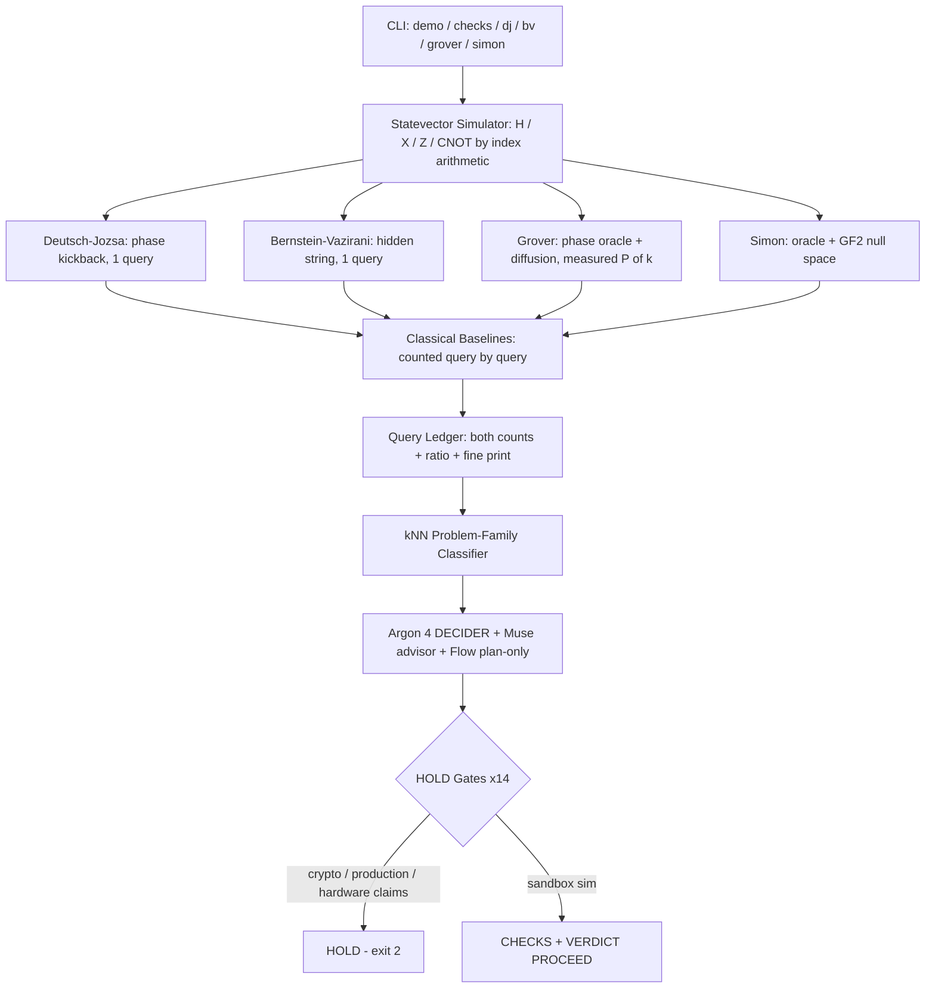
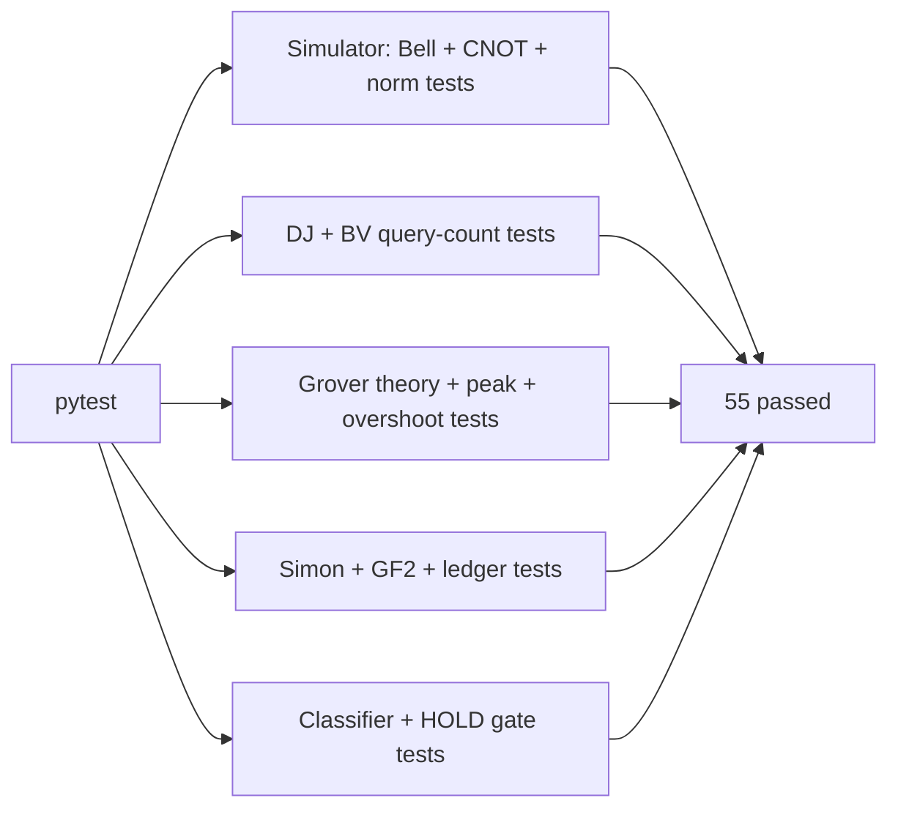
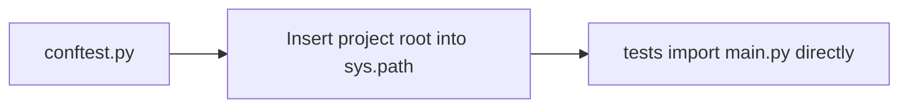
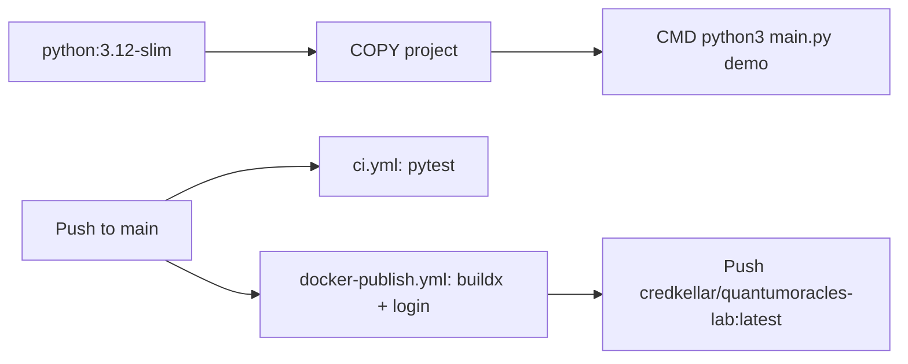

# QuantumOracles-Lab 🔮⚛️

**Quantum Oracle Algorithms Lab** — by Darion Kellar

QuantumOracles-Lab is an **educational quantum oracle algorithms lab** in ONE pure-Python file. It builds the four textbook oracle algorithms on a **from-scratch statevector simulator** — 2^n complex amplitudes, exact arithmetic, no sampling noise — and **counts every oracle call on both sides**:

- **Deutsch-Jozsa** — constant vs balanced decided in exactly **1 quantum query** for n = 1..6, against a classical worst case of **2^(n-1) + 1** that is *counted* on constant and adversarial instances (17 at n = 5, 33 at n = 6) ⚖️
- **Bernstein-Vazirani** — the hidden string (s = 101101 at n = 6) recovered in exactly **1 query** with probability exactly 1.0, against exactly **n** classical queries, counted one bit at a time 🧵
- **Grover search** — success probability *measured* off the simulated state at every iteration: at N = 16 it climbs 0.062500 → 0.472656 → 0.908447 to a peak of **0.961319 at k = 3** = round(π/4·√N) — then **overshoots**, falling to 0.581704 and 0.125492, printed in the same table 🎯
- **Simon's problem** — the hidden period s = 1011 (n = 4) recovered by **from-scratch GF(2) Gaussian elimination** over the sampled equations, in **5 quantum queries vs 9 counted classical** collision queries 🧩
- A **query ledger** that prints both counts and the ratio for all four algorithms — no speedup word anywhere without the counts beside it — and a from-scratch **kNN problem-family classifier** whose training grid is generated by running the lab's own algorithms 📒

Honest scope, stated up front: these are **query-complexity statements about the oracle model**. One query means one application of a black-box unitary that a real machine would have to build out of gates, on a promised problem (constant-or-balanced, a hidden linear string) chosen so the separation is provable. They are **not** claims of practical speedup on real problems, real databases, or real cryptography — and the simulator itself is classical and exponential: n qubits cost 2^n amplitudes, stated wherever a size is printed. Nothing here ran on quantum hardware. Every crypto-breaking / production / hardware claim sits behind a permanent HOLD gate (14 total). 🔒

[](https://github.com/kimanicollier44-cmyk/QuantumOracles-Lab/actions/workflows/ci.yml)
[](https://github.com/kimanicollier44-cmyk/QuantumOracles-Lab/actions/workflows/docker-publish.yml)

> ℹ️ These are the **live** workflow badges for this repo. They activate as soon as the `ci.yml` and `docker-publish.yml` files from the paste pack are pasted into `.github/workflows/` — until then they have nothing to report yet.

## 🧰 Tech Stack Badges & Full Architecture Tech Stack

### 💻 Core Programming Languages & Core Systems


%20Solve-2ea44f)

- 🐍 Python 3.12, pure standard library (`math`, `hashlib`, `json`, `sys`) — zero dependencies, zero network, deterministic (double-run byte-identical)
- 🔮 Statevector simulator core: H / X / Z / CNOT applied by index arithmetic on 2^n complex amplitudes, oracle unitaries as exact permutations / phase flips, diffusion as inversion about the mean — every probability asserted against its analytic value in CHECKS
- 🔢 GF(2) linear algebra from scratch: Gaussian elimination to reduced row echelon form, null-space extraction for Simon's post-processing
- 🧠 TinyML kNN problem-family classifier (from scratch, stdlib): deutsch-jozsa / bernstein-vazirani / grover / simon from query counts + success probability + output structure
- 🪑 Council seats: Gemini Argon 4 DECIDER (names-only, tighten-only) + Muse advisor (never overrides HOLD) + Google Flow plan-only (rendered = False, live = 0)

### ⛓️ Web3 & Infrastructure

- 🚫 **Not applicable — honestly.** No blockchain, no Web3, no tokens: the "infrastructure" in this lab is one offline file holding a simulated quantum register, four oracle circuits, and a paper query ledger. No fake badges here.

### ⚙️ Platform Support & Hardware Architecture


- 🖥️ Pure Python — runs anywhere Python 3.12+ runs (Linux, macOS, Windows), plus the `python:3.12-slim` Docker image
- 🔒 No quantum hardware is touched, ever: real QPUs, cloud quantum services, and hardware benchmarks are permanent HOLD gates (see the gate table below)

### ⚡ Low-Level Infrastructure & Performance

- 🚫 **No low-level code — honestly.** No C, no C++, no GPU, no compiled extensions: this is one interpreted Python file on purpose, so every amplitude can be read, checked, and diffed. Performance here means honest counting — the simulator's own cost is the lesson: 2^n amplitudes, exponential in n, printed wherever a size appears.

### 🛠️ DevOps & Build Tools


- 🐳 Docker (`python:3.12-slim`), GitHub Actions CI + Docker Publish (delivered in the paste pack)
- 🎯 Target image: `credkellar/quantumoracles-lab:latest`
- 🧪 Tests: `pytest` (55 tests) + the built-in CHECKS suite (42 checks) in `main.py`

### ☁️ Cloud Providers

- 🚫 **None — honestly.** No cloud provider is used or needed: the lab runs fully offline on your own machine or in a local Docker container. Docker Hub appears only as the registry the publish workflow pushes the image to.

## What this does?

1. 🧮 **Statevector simulator, from scratch** — a state is a list of 2^n complex amplitudes; H, X, Z, and CNOT are applied by index arithmetic (qubit q = bit q of the index). The checks pin it down before any algorithm is trusted: the Bell state comes out at exactly P(00) = P(11) = 0.5, the CNOT truth table holds on all four basis states, and the norm stays 1.0 through a mixed gate sequence.
2. ⚖️ **Deutsch-Jozsa** — the oracle U_f acts on n input qubits plus an ancilla prepared in |−⟩, so f kicks back as a phase. After one application and a Hadamard layer, the all-zero outcome has probability **exactly 1.0 iff f is constant, exactly 0.0 iff balanced** — verified for constant 0, constant 1, parity-balanced, first-bit-balanced, and adversarial-balanced instances at every n = 1..6. Quantum cost: **1 query, every time**.
3. 🔢 **The classical DJ worst case, counted** — the classical strategy queries inputs in order and stops at the first differing pair or after 2^(n-1) + 1 equal answers. Run against constant functions *and* an adversarial balanced function (0 on the whole first half, 1 on the second), it spends exactly **2^(n-1) + 1** queries: 5 at n = 3, 17 at n = 5, 33 at n = 6. (Against parity-balanced it finishes in 2 — the worst case is a worst case, and the lab shows both.)
4. 🧵 **Bernstein-Vazirani** — the same phase-kickback circuit with f(x) = s·x (mod 2) leaves the input register in exactly |s⟩: the hidden string is recovered in **1 query with probability exactly 1.0**, for strings up to n = 6 (s = 101101 in the headline run). The classical baseline reads s one bit per query via the unit vectors — **exactly n queries, counted**.
5. 🎯 **Grover, measured** — each iteration is one phase-oracle call (counted) plus inversion about the mean. The success probability is read off the simulated state, not the formula: at N = 16, marked 9 — k = 0: 0.062500, k = 1: 0.472656, k = 2: 0.908447, **k = 3: 0.961319**, k = 4: 0.581704, k = 5: 0.125492. Every measured value is checked against sin²((2k + 1)θ) to 2e-6, and the measured peak sits exactly at the formula k = round(π/4·√N) for N = 8, 16, 32, 64.
6. 📉 **Overshoot, shown** — past the optimum the Grover rotation keeps turning and the success probability *falls*: 0.961319 → 0.581704 → 0.125492. The table prints the fall in the same run as the peak — iterate too long and you rotate past the answer.
7. 🔍 **Grover's classical baseline, counted** — linear search is run for *every* possible marked position and averaged: (N + 1)/2 = **8.5 expected queries** at N = 16 (about N/2), against 3 quantum iterations at the optimum.
8. 🧩 **Simon's problem with real post-processing** — f(x) = min(x, x ⊕ s) is two-to-one with hidden period s by construction (proven in the checks). Each quantum run costs **1 oracle query** and yields one equation y·s = 0; at n = 4 the runs sample 0011, 0100, 0111, 1001, and from-scratch GF(2) Gaussian elimination (null space of the equation system) recovers **s = 1011** after **5 runs**. Measurement outcomes are enumerated in a fixed rotating order in place of random sampling — labelled in the report; the per-run query cost is exact.
9. 🏃 **Simon's classical baseline, counted** — querying f in input order until the first collision exposes s = x₁ ⊕ x₂: at n = 4, s = 1011 the collision lands on the **9th query** (5th at n = 3, s = 101). In general this direct search faces the birthday bound — the quantum post-processing is polynomial in n.
10. 📒 **Query ledger + classifier + seats + checks** — one ledger table for all four algorithms (DJ 1 vs 17 → 17.0×, BV 1 vs 6 → 6.0×, Grover 3 vs 8.5 → 2.8333×, Simon 5 vs 9 → 1.8×), each row naming how its classical count was obtained and carrying the fine print *"query-complexity statement about the oracle model only"*. A from-scratch kNN then identifies the problem family from a run's signature (training grid generated by the lab's own runs), with Argon 4 DECIDER (sha256 trace), Muse advisor, Google Flow plan-only, and a built-in CHECKS suite (42 checks).

## 🗺️ How it works — diagram per script

### `main.py` — the whole lab



### `tests/test_main.py` — verification



### `conftest.py` — test path setup



### `Dockerfile` + CI flow — container & publish



## Why is this cool?

1. ⚖️ Deutsch-Jozsa's gap is **counted, not quoted**: 1 quantum query against 17 classical at n = 5 — and the 17 is earned by actually running the classical strategy against an adversary built to waste its time.
2. 🧵 Bernstein-Vazirani pulls a whole 6-bit string out of **one** oracle call with probability exactly 1.0 — the cleanest possible demo of phase kickback doing real work.
3. 🎯 Grover's peak is **measured off the state**, then checked against the formula — and the formula k = round(π/4·√N) lands on the measured peak at N = 8, 16, 32, and 64.
4. 📉 The overshoot is in the table: iterate past the optimum and the success probability collapses from 0.961319 to 0.125492 — the rotation picture teaches itself.
5. 🧩 Simon's post-processing is the real thing: actual GF(2) Gaussian elimination recovering s = 1011 from raw sampled equations, not a lookup.
6. 📒 The query ledger is an honesty device: every separation ships with both counts, the counting method, and its fine print in the same row.
7. 🏷️ The classifier learns from the lab's own runs — its training grid is generated by executing the four algorithms, so its labels can never drift from the code.
8. 🔍 Both baselines are *run*, not asserted: Grover's 8.5 is an average over every marked position; Simon's 9 is a real collision search hitting a real collision.
9. 🧪 The simulator is pinned by physics first: Bell probabilities, the CNOT truth table, and norm preservation are checked before any algorithm's numbers are believed.
10. 🎯 Deterministic end to end: run it twice, get byte-identical output — a quantum-algorithms lab you can diff.

## What problems this solves?

1. ❌ **Problem:** "Quantum speedup" claims float around with no numbers attached. ✅ **Solution:** Every algorithm reports quantum queries, classical queries, and the ratio in one ledger — the counts are the claim, and there is no other claim.
2. ❌ **Problem:** Textbook DJ/BV separations are stated as theorems and never touched. ✅ **Solution:** The circuits really run on a simulator in this file; the 1-query verdicts come out of measured state probabilities (exactly 1.0 / 0.0).
3. ❌ **Problem:** The classical worst case 2^(n-1) + 1 is usually just asserted. ✅ **Solution:** It is counted against an adversarial balanced function designed to survive exactly that long — and the easy parity case (2 queries) is shown too, so worst case is not confused with typical case.
4. ❌ **Problem:** Grover is taught as "√N search" with the overshoot quietly dropped. ✅ **Solution:** The full P(k) table is measured and printed past the peak — 0.961319 → 0.581704 → 0.125492 — so the cost of over-iterating is a number, not a footnote.
5. ❌ **Problem:** Simon's algorithm is usually left at "and then solve the linear system". ✅ **Solution:** The GF(2) elimination is implemented from scratch and its null space is the recovered period; the sampled equations are printed in the demo.
6. ❌ **Problem:** Simulation results get marketed as hardware results. ✅ **Solution:** The honest-scope paragraph leads the README and the docstring, `quantum_hardware_claim` is a permanent HOLD gate, and the simulator's exponential cost (2^n amplitudes) is printed wherever a size appears.
7. ❌ **Problem:** Query complexity gets conflated with wall-clock speedup. ✅ **Solution:** The ledger's fine print — "query-complexity statement about the oracle model only" — is attached to every row, and `real_world_speedup_claim` is gated.
8. ❌ **Problem:** Oracle demos get repackaged as crypto-breaking. ✅ **Solution:** `crypto_breaking_claim` and `password_or_hash_cracking` are permanent HOLD gates returning exit code 2; the lab's Grover searches a labelled 16-item toy list and says so.
9. ❌ **Problem:** Classical baselines are often strawmen (or silently optimal). ✅ **Solution:** Each baseline is the honest textbook strategy — unit-vector reads for BV (provably optimal), full-position averaging for Grover, collision search for Simon — and its counting method is named in the ledger.
10. ❌ **Problem:** Algorithm demos hide their sampling conveniences. ✅ **Solution:** Simon's deterministic stand-in for random measurement is labelled in the report itself ("enumerated in a fixed rotating order"), while the per-run query cost stays exact.

## How to install this?

1. 📋 Clone or download this project folder.
2. 🐍 Make sure Python 3.12+ is installed: `python3 --version`
3. ▶️ Run the full demo + checks (no arguments needed):

```bash
python3 main.py
```

4. 🧪 Run the test suite:

```bash
pip install pytest
python3 -m pytest -q
```

5. 🎛️ Try the other commands:

```bash
python3 main.py checks      # 42 built-in checks
python3 main.py dj          # Deutsch-Jozsa report at n=5 (JSON)
python3 main.py bv          # Bernstein-Vazirani report, n=6 s=101101 (JSON)
python3 main.py grover      # Grover measured P(k) table at N=16 (JSON)
python3 main.py simon       # Simon period recovery report (JSON)
python3 main.py ledger      # query ledger: both counts, every algorithm
python3 main.py classify    # kNN problem-family classifier report
python3 main.py brains      # Argon 4 + Muse + Flow seats
python3 main.py holds       # list all 14 HOLD gates
python3 main.py hold-demo   # exits 2 - gated actions stay HOLD
```

6. 🐳 Or run it in Docker:

```bash
docker build -t credkellar/quantumoracles-lab:latest .
docker run --rm credkellar/quantumoracles-lab:latest
```

## Requirements

- 🐍 Python 3.12 or newer
- 📦 Dependencies: **none** (standard library only)
- 🌐 Network: **none** — fully offline
- 🧪 For tests only: `pytest`
- 🐳 Optional: Docker

## FULL project structure tree

```text
quantumoracles-lab/
├── main.py                  # the whole lab: statevector simulator, Deutsch-Jozsa, Bernstein-Vazirani, Grover, Simon + GF(2), query ledger, classifier, seats, HOLD gates
├── conftest.py              # puts the project root on sys.path for tests
├── tests/
│   └── test_main.py         # 55 pytest tests: simulator, DJ, BV, Grover, Simon, ledger, classifier, gates, determinism
├── assets/
│   └── cover.png            # README cover image (2736 x 912)
├── Dockerfile               # python:3.12-slim, runs the demo
├── .gitignore               # __pycache__/, .pytest_cache/, *.pyc
└── README.md                # this file
```

> 📦 Delivered separately as paste packs (not in this tree): `.github/workflows/ci.yml` + `docker-publish.yml`, and the Docker Hub pack (100-char description, 350-char About, overview, categories).

## 🔒 HOLD gates — all 14, permanent

| # | Gate | What stays held |
|---|------|-----------------|
| 1 | `crypto_breaking_claim` | No claim of breaking real cryptography; oracle separations are query-model statements, not attacks |
| 2 | `password_or_hash_cracking` | No live password, PIN, or hash cracking; Grover here searches a labelled toy list only |
| 3 | `real_world_speedup_claim` | No practical-speedup claim on real problems; every separation is printed with its query counts |
| 4 | `quantum_hardware_claim` | No claim of access to, or results from, real quantum hardware; this is a classical simulation |
| 5 | `production_use_claim` | No production deployment claim; a teaching simulator is not a product |
| 6 | `database_search_product_claim` | No claim Grover speeds up a real database; real data has structure and loading costs this model omits |
| 7 | `financial_advantage_claim` | No trading, pricing, or financial-advantage claim from query counts |
| 8 | `medical_or_drug_claim` | No drug-discovery, molecular, or medical claim from these toy circuits |
| 9 | `security_bypass_claim` | No using oracle demos to claim bypass of any real access control, login, or security check |
| 10 | `benchmark_vendor_claim` | No vendor or hardware benchmark claim; counts are against this file's own classical baselines |
| 11 | `surveillance_claim` | No surveillance, tracking, or intelligence-collection use or claim |
| 12 | `patent_or_priority_claim` | No patent, priority, or first-discovery claim; these are textbook algorithms from the 1990s |
| 13 | `investment_claim` | No investment claim; a query ledger is not a prospectus |
| 14 | `certification_claim` | No certification, accreditation, or compliance claim of any kind |

🧑‍⚖️ **Council seats:** Gemini Argon 4 Extended Thinking — DECIDER (names-only, tighten-only, MAP → MODEL → STRESS → DECIDE, sha256 trace, `can_override_hold = False`) · Muse — advisor (`can_override_hold = False`) · Google Flow — plan-only (`rendered = False`, `live = 0`).

✅ **Verification:** pytest **55 passed** (project + clean copy) · built-in CHECKS **42/42** · double-run output **byte-identical** · `hold-demo` exits **2** · `main.py` **1,074 lines**, pure stdlib, zero network.

## 🧒 5th-grade English section

Imagine a magic box that answers yes-or-no questions about a secret rule. You may ask the box questions, and we **count every question** — that counting is the whole game. 🎲

- One game asks: "Is your rule the same for everything, or does it flip half the time?" A normal detective might need **17 questions** to be sure. The quantum detective asks **once** — the box's answer is hidden inside a wave, and the wave remembers all the answers at the same time. ⚖️
- Another game hides a secret word made of 1s and 0s. Normally you need one question per letter. The quantum way reads the **whole word with one question**. 🧵
- A third game hides one special marble in a box of 16. Guessing one by one takes about 8 or 9 tries. The quantum way does a special shuffle that makes the special marble **glow brighter** — but shuffle too many times and the glow fades again! This lab shows the bright moment *and* the fading. 🎯
- The last game hides a repeating pattern, like a secret echo. The quantum detective collects a few clues and solves them with a special kind of math homework (over GF(2)) to find the echo. 🧩
- Every game in this lab keeps a **scorebook**: how many questions the quantum way used, and how many the normal way used, side by side. No scorebook, no bragging. 📒
- This is a **pretend lab on a computer** — the "quantum" box is really just careful math inside one Python file. It does not break any real codes or passwords. It teaches you why counting questions is one of the fairest ways to compare two ways of solving a puzzle. 💻

---

MIT © 2026 Darion Kellar · QuantumOracles-Lab — educational simulation only 🔮
